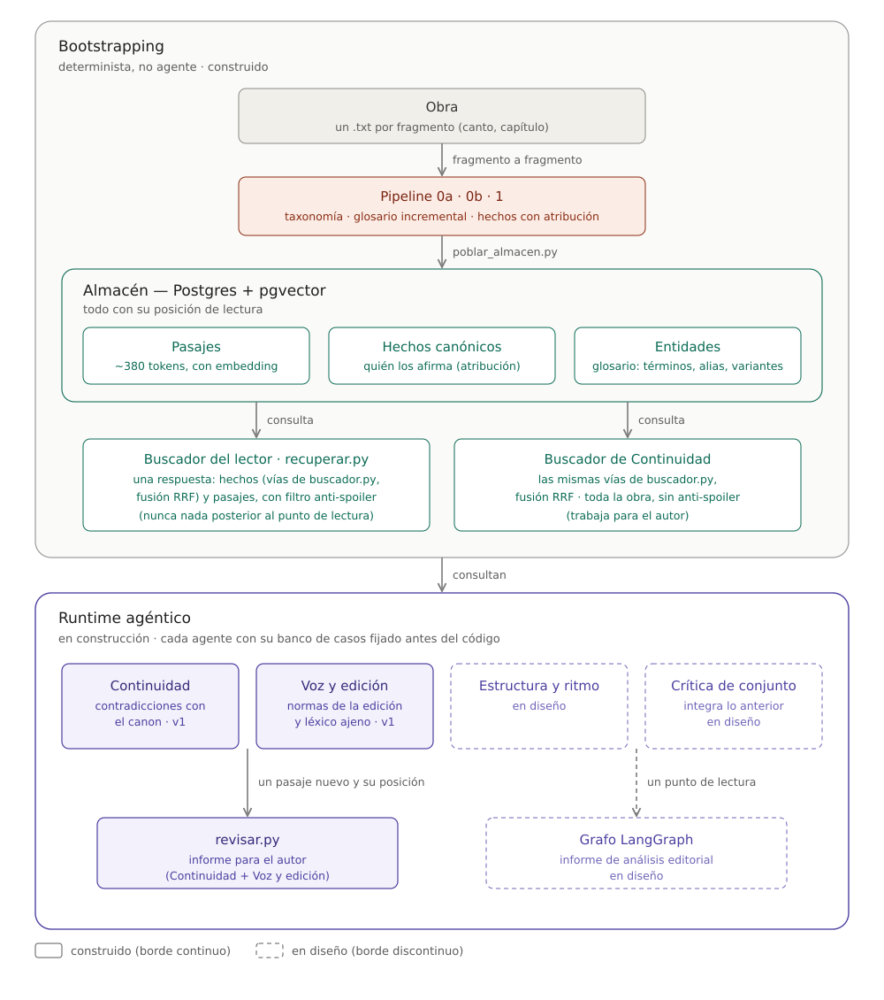

# Sistema agéntico de evaluación editorial de textos narrativos

Un lector automático al que le pides un informe de lectura —¿la trama es
coherente?, ¿los personajes son consistentes?, ¿hay agujeros argumentales?—
tiene el mismo problema de fondo que un corrector de estilo: no tiene memoria
fiable del resto de la obra. Puede señalar como contradicción algo que el
propio texto ya resolvió cien páginas antes, o dar por hecho objetivo lo que
no era sino la fanfarronada de un personaje.

Este proyecto es un intento — todavía en marcha — de construir la base que
un sistema de evaluación editorial necesita para no cometer ese error: no un
agente que reescribe o corrige el texto, sino uno que lo **analiza** —en los
mismos ejes que usaría un lector profesional de editorial: estructura, trama,
personajes, cronología, construcción del mundo, ritmo, temas, simbolismo,
consistencia interna— apoyándose en un canon fijado de antemano, no en lo
que el modelo recuerde a bulto del contexto.

La arquitectura tiene dos partes bien separadas — el diagrama las agrupa en
dos cajas para que se distingan a simple vista: **Bootstrapping**
(determinista, construido) y **Runtime agéntico** (en construcción). Dentro
de esas cajas, el borde continuo marca lo que ya está construido y el
discontinuo lo que todavía no:



1. **Bootstrapping** (determinista, no agente): todo lo que correría una
   sola vez sobre la obra (y después, fragmento a fragmento, a medida que
   la obra crece). El pipeline de extracción, el almacén y la parte
   semántica del retriever están implementados:
   - **Fase 0a — taxonomía documental** *(implementado)*: identifica qué
     tipos de documento contiene la obra (narración, diálogo, documentos
     insertados, paratexto editorial...), a partir de fragmentos reales de
     esa obra, no de una lista genérica fija.
   - **Fase 0b — glosario calibrado** *(implementado)*: identifica
     personajes, lugares, pueblos, objetos y conceptos, fusionando las
     distintas formas en que la obra nombra al mismo referente (epítetos,
     patronímicos, apelativos). Es **incremental**: al añadir un fragmento
     nuevo, conserva todos los términos ya fijados y solo añade lo nuevo.
   - **Fase 1 — extracción con atribución** *(implementado)*: usa esa
     calibración como contexto y extrae hechos canónicos, marcando quién
     respalda cada uno: `narrador_documental` (el narrador o un documento),
     `testimonio_directo_narrador` (el narrador en primera persona, sin
     nada en juego) o `afirmacion_interesada` (alguien con algo que ganar
     en que se le crea, sin verificación independiente).
   - **Almacén — Postgres + pgvector** *(implementado)*: guarda lo
     anterior en dos formas — la prosa de la obra troceada en pasajes de
     ~380 tokens y vectorizada (para recuperación semántica) y las fichas
     canónicas de la Fase 1, ambas con su posición en el orden de lectura.
   - **Buscador del lector** *(implementado; su banco con base de datos,
     sin ejecutar)*: `recuperar.consultar` da en una sola respuesta los
     hechos más relevantes para una consulta y los pasajes más parecidos,
     con un **filtro anti-spoiler**: dado un punto de lectura, nunca
     devuelve nada posterior. Especificación en
     [`docs/buscador_lector.md`](docs/buscador_lector.md).
   - **Buscador híbrido del agente de Continuidad** *(implementado)*:
     hechos por entidad y búsqueda léxica sobre los hechos (texto completo
     de Postgres), fusionados por rango recíproco. Las vías y la fusión
     están en `buscador.py`, compartidas con el del lector. Sin filtro anti-spoiler,
     porque trabaja para el autor y le importa también lo que viene
     después. Su diseño salió del banco del agente: ver
     [`docs/buscador_hibrido.md`](docs/buscador_hibrido.md).
2. **Runtime agéntico** *(en construcción)*: el grafo de agentes
   (LangGraph) que consultaría el retriever para producir el análisis
   editorial. Cuatro agentes especializados compartirían ese retriever pero
   evaluarían ejes distintos — continuidad y coherencia interna, voz
   narrativa, estructura y ritmo, y una crítica de conjunto que integra lo
   anterior — para producir un informe de análisis editorial, no texto
   reescrito.
   - **Continuidad** *(implementado, v1)*: `continuidad.py`, especificación
     en [`docs/agente_continuidad.md`](docs/agente_continuidad.md). Una
     herramienta del autor: dado un pasaje que se va a insertar, avisa de lo
     que contradice el canon, antes o después del punto de inserción. Solo
     un hecho del narrador puede fundar un aviso; lo que afirma un personaje
     da, como mucho, una nota. Usa el mismo modelo que el resto de fases.
     En su banco de 27 casos (Cantos III y IV) detectó 14 de 16
     contradicciones sin ningún aviso falso.
   - **Voz y edición** *(implementado, v1; banco con API sin ejecutar)*:
     [`docs/agente_voz.md`](docs/agente_voz.md). Avisa de lo que se aparta
     de la voz de la obra, pero solo de lo que se puede medir en ella: las
     normas de la edición (en la Segalá, «á», «fué», el diálogo entre «»)
     y las palabras que la obra no usa nunca y que suenan anacrónicas o
     coloquiales en ella.
   - **Informe para el autor** *(implementado)*: `revisar.py` pasa un
     pasaje nuevo por Continuidad y por Voz y edición y reúne sus informes.
     No añade criterio propio; si un agente falla, el informe lo dice y el
     otro sigue.
   - **Estructura y ritmo, crítica de conjunto** *(en diseño)*.

## Por qué calibrar antes de extraer

Pedirle a un modelo que extraiga personajes y hechos directamente funciona,
hasta que ejecutas el mismo fragmento dos veces y decide categorías distintas,
o segmenta el mismo personaje bajo dos nombres como si fueran dos entidades.

Por eso el pipeline calibra primero, específicamente para la obra que se le
dé — sin listas fijas inventadas a mano. Cada fase de la Fase 0/1 anterior
corresponde a un script:

| Fase | Script | Detalle |
|---|---|---|
| 0a | `calibrar_taxonomia.py` | Una pasada suele bastar: los marcadores de tipo documental (mayúsculas, notas al pie, etiquetas de hablante) son explícitos. |
| 0b | `calibrar_glosario.py` | Ejecuta N pasadas independientes (por defecto 3) y reconcilia por mayoría, registrando el disenso en vez de ocultarlo — la categoría de una entidad es más ambigua y el modelo no converge igual dos veces. Si la obra ya tiene glosario, solo calibra los fragmentos nuevos y no toca lo ya fijado (`--desde-cero` para recalibrar todo). |
| 1 | `extraer_canon.py` | Carga la calibración de 0a y 0b como contexto del prompt de sistema, con prompt caching para no volver a pagar ese contexto en cada fragmento. |

## Caso de estudio: Canto I de la Ilíada

`data/ejemplos/iliada-canto-i/` contiene el fragmento fuente
(`iliada_canto_i.txt`, traducción en prosa del siglo XIX) y la calibración
real (Fases 0a y 0b) ejecutada sobre él — un texto ajeno a cualquier obra
propia, usado como caso de prueba neutral para comprobar que el sistema no
está sobreajustado a un único estilo o estructura narrativa.

Resultados destacables:

- La Fase 0a distinguió, sin que se le pidiera explícitamente, entre la
  narración del poema y el aparato editorial de la edición (encabezados de
  canto, pies de ilustración) — con confianza más baja para este último,
  correctamente, por ser un añadido del editor y no del poema.
- La Fase 0b fusionó correctamente cinco formas distintas de referirse a
  Agamenón ("Atrida", "Atrida Agamenón", "hijo de Atreo", "rey de hombres
  Agamenón"...) en las tres pasadas, sin disenso.
- También registró un desacuerdo real: el término "hecatombe" se dividió
  entre las pasadas que lo clasificaron como objeto ritual concreto y las
  que lo trataron como concepto abstracto — ver
  `discrepancias_calibracion.json`. Ambigüedad legítima del texto, no ruido
  del modelo.

## Estructura del repo

```
src/
  calibrar_taxonomia.py   # Fase 0a
  calibrar_glosario.py    # Fase 0b
  extraer_canon.py        # Fase 1
  poblar_almacen.py       # Fase 2: carga en Postgres + pgvector
  recuperar.py            # Búsqueda con filtro anti-spoiler (buscador del lector)
  buscador.py             # Vías de hechos y fusión, comunes a los dos buscadores
  continuidad.py          # Agente de Continuidad v1 y su buscador híbrido
  voz.py                  # Agente de Voz y edición v1 (docs/agente_voz.md)
  revisar.py              # Informe para el autor: Continuidad + Voz y edición
docs/
  agente_continuidad.md   # Especificación del agente de Continuidad
  buscador_hibrido.md     # Especificación del buscador, con la medida que lo decidió
  buscador_lector.md      # Especificación del buscador del lector
  agente_voz.md           # Especificación del agente de Voz y edición
tests/
  SPECS.md                # Qué debe cumplir cada fase y qué prueba lo comprueba
  continuidad/            # Banco de casos del agente de Continuidad
  voz/                    # Banco de casos del agente de Voz y edición
  fijos/                  # Cantos I-IV de la Ilíada y respuestas reales de Claude
data/
  ejemplos/
    iliada-canto-i/       # Salida real de calibración sobre el Canto I
  <obra>/exports/         # (no versionado) salida de tus propias ejecuciones
```

## Uso

Requiere Python 3.11+, [`uv`](https://github.com/astral-sh/uv), y una
`ANTHROPIC_API_KEY` en el entorno.

```bash
# Fase 0a — taxonomía documental (una pasada suele bastar)
uv run python src/calibrar_taxonomia.py --obra=mi_obra --n=1 data/novelas/fragmento.txt

# Fase 0b — glosario calibrado (varias pasadas + reconciliación).
# La primera vez calibra desde cero; las siguientes, solo los fragmentos nuevos.
uv run python src/calibrar_glosario.py --obra=mi_obra --n=3 data/novelas/fragmento.txt

# Fase 1 — extracción con atribución (usa la config generada arriba)
# --orden=N es la posición de lectura de este fragmento en la obra
uv run python src/extraer_canon.py --obra=mi_obra --orden=1 data/novelas/fragmento.txt

# Fase 2 — carga en el Almacén (ver INSTALL.md)
uv run python src/poblar_almacen.py --obra=mi_obra --exports=data/mi_obra/exports

# Búsqueda: lo que se sabe hasta el final del fragmento 1, sin spoilers
uv run python src/recuperar.py --obra=mi_obra --hasta-fragmento=1 "consulta"

# Continuidad: qué contradice el canon un pasaje que se insertaría en el
# carácter 12345 del fragmento 4
uv run python src/continuidad.py --obra=mi_obra --orden=4 --char=12345 --fichero=pasaje.txt
# Por defecto busca por entidades y léxica, con un tope de 60 hechos.
# Se pueden elegir otras vías (docs/buscador_hibrido.md) y otro tope:
uv run python src/continuidad.py --obra=mi_obra --orden=4 --char=12345 --fichero=pasaje.txt \
    --vias=entidades,entorno,lexica --tope=200

# Las dos revisiones del autor juntas (o solo algunas, con --agentes=voz)
uv run python src/revisar.py --obra=mi_obra --orden=4 --char=12345 --fichero=pasaje.txt

# Voz y edición: normas de la edición y palabras ajenas a la obra
uv run python src/voz.py --obra=mi_obra --orden=4 --char=12345 --fichero=pasaje.txt
```

Cada obra escribe en su propia carpeta, `data/<obra>/exports/`. Si
`extraer_canon.py` no encuentra la config de la Fase 0, avisa por consola y
extrae igualmente, sin esa ayuda.

## Pruebas

Tres niveles, de más rápido a más caro (detalle en
[`tests/SPECS.md`](tests/SPECS.md)). La suite rápida se ejecuta en cada PR
y en cada push a `main` (GitHub Actions, Python 3.11 y 3.13):

```bash
uv pip install -r requirements-dev.txt

# Rápido (segundos): sin base de datos ni API. Incluye las fases que
# llaman a Claude, con respuestas reales grabadas en tests/fijos/.
uv run pytest

# Con base de datos (Postgres + pgvector): carga, recarga y filtro anti-spoiler.
# Crea su propia base de datos, almacen_test; nunca toca almacen.
uv run pytest --db

# Contra la API real (con coste): las mismas specs sobre respuestas nuevas.
uv run pytest --api tests/api

# Banco del agente de Continuidad (base de datos + API real, 27 llamadas).
uv run pytest --db --api tests/continuidad

# ... llamando solo en los casos cuyo contexto cambió respecto a la
# respuesta grabada (al cambiar el buscador).
NOVELA_BANCO_SOLO_CAMBIADOS=1 uv run pytest --db --api tests/continuidad

# Banco del agente de Voz y edición (solo API, sin base de datos).
uv run pytest --api tests/voz

# Informe del buscador: cobertura del contexto por combinación de vías,
# sin API (.cache/continuidad/buscador.txt).
uv run pytest --db -s tests/continuidad/test_contexto_db.py -k buscador
```

## Estado del proyecto

Exploratorio, documentado tal como es. El pipeline de extracción (Fases 0a,
0b y 1), el almacén Postgres + pgvector y la búsqueda con filtro
anti-spoiler están implementados y cubiertos por pruebas, comprobados con
los Cantos I-IV de la Ilíada.

El agente de Continuidad v1 funciona: en su banco detectó 14 de 16
contradicciones sin ningún aviso falso. Su buscador híbrido se eligió
midiendo la cobertura del contexto sin API, y por defecto usa entidades y
búsqueda léxica con un tope de 60 hechos. Falta repetir con la API los
casos del banco cuyo contexto cambió con ese buscador.

El agente de Voz y edición y el buscador del lector están escritos y
probados en la suite rápida, a falta de ejecutar sus bancos con API y con
base de datos. Siguen en diseño Estructura y ritmo y Crítica de conjunto.

## Licencia

MIT. Ver [LICENSE](LICENSE).
